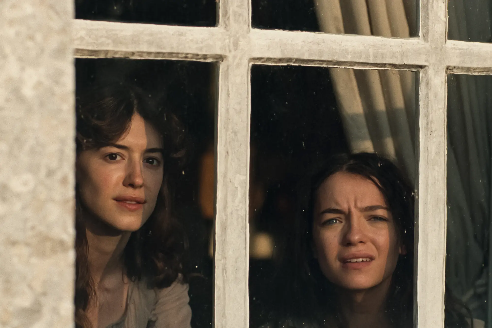

When I was twelve years old I made a radical decision: I wanted to become a filmmaker. I was hot off the tails of having completed my first film, a ten minute documentary made about [The Gatling Gun](https://www.imdb.com/title/tt5275096/) that I made for a school project, and I decided that I had found my calling. Over the next six years of public schooling I would dedicate myself fully to learning as much as I possibly could about the craft that I had become so entranced by. I spend time reading and learning about directors, editors, screenwriters even visual effects artists and composers in an effort to decided how specifically I wanted to enter into the world I decided I needed to be a part of. I continued making short-subject documentaries and started making short films starring just myself, or my little brother when I could convince him to [join in with me](/downloads/Hostility.mp4). But above all I spent hundreds of hours watching as many films as I could get my hands on. Throughout this time I learned to appreciate all the various aspects of the film-making process. I'd spend weeks learning as much as I could about what precisely a focus puller did on set, or how foley artists created sound effects. But throughout all of this time I have always under appreciated the roll of an actor. 

Don't misunderstand what I mean to say here: I love Daniel Day-Lewis, Philip Seymour Hoffman and every other thrice-named star as much as the next guy. Certainly, I'm capable of appreciating a great performance when I see one, I did come to maturity at the height of Heath Ledgers incredible work in "The Dark Knight" after-all. But that never quite changed the fact that I never really valued actors as doing something all that incredibly in terms of their contribution to the film. Certainly, I never understood how exactly how $100 Million of a box office hit with a $300 Million budget ended up going to four or five of the leading cast members. In part this was certainly informed by my love of filmmakers like Alfred Hitchcock, Stanley Kubrick and (to a somewhat lesser extent) David Fincher, who all have a reputation for disregarding andior under-appreciating the contributions of those who they captured on film. Certainly, even now as I write this though, it does still seem like the roll of an actor is often over-sold when ranked in comparison to the magical work by everyone else behind the scenes. But that doesn't change the fact that I've recently had my notion of the value of acting changed, after my viewing of this years adaptation of Jane Austen's "Sense and Sensibility". 

    <a href="https://www.imdb.com/name/nm8402992/">Daisy Edgar-Jones</a> (left) and 
    <a href="https://www.imdb.com/name/nm2962727/">Esmé Creed-Miles</a> (right) in the obligatory still frame from the film in an essay about a film.

There are actually quite a few individual sequences in this film that I could point to as evidence or great performances given by the cast in Sense and Sensibility. I was impressed by Esmé Creed-Miles' performance in particular throughout the film. But rather than break down a 200 year old story beat by beat, I'd rather just share a chain of thought that occurred to me while I was walking out of the screening: 

While leaving the film, I began to think about the prospect of undertaking my own adaptation of a novel. After all, I did spent at least a decade in my youth dreaming of making films, and even if I've changed my mind about that dream, it's not like I still don't think about the possibility or have lost interest in the art-form. There are even a few novels which I have loved greatly and think would be wonderful films if given and adaptation, Nikos Kazantazakis' "The Fratricides", and Hemmingway's "A Farewell to Arms" or "Old Man and the Sea" come to mind almost immediately. But weirdly enough the process of adapting a classic text didn't actually feel that daunting, as I considered it. This is was an odd experience for me, as even when I was the most enthusiastic about my former dream of film-making, the idea of actually being handed the reigns of a multi-million dollar art project filled me with fear and dread. Now it seemed to me that the job of adapting a brilliant novel, actually seemed pretty straightforward. As far as the screen writing process is concerned is seemed like the only real challenge would be deciding what to cut that couldn't be filmed or would in some way break the adaption technically. Certainly adapters of classics have also gotten themselves into hot water with viewers in the past by reinterpreting or adding on to a classic work, but it seems pretty easy to just not do that. As far as directing the film is concerned, it seems reasonably easy enough, at the very least no harder than directing any other type of film, but with the great benefit of having had someone else already create a beloved story for you to work with. In fact, nearly every job on the set of Sense and Sensibility or any similar work, seems made easier by the behemoth of an elephant in the room, the source text.

But it seems to me that the inverse is true for the talent in front of the camera.
