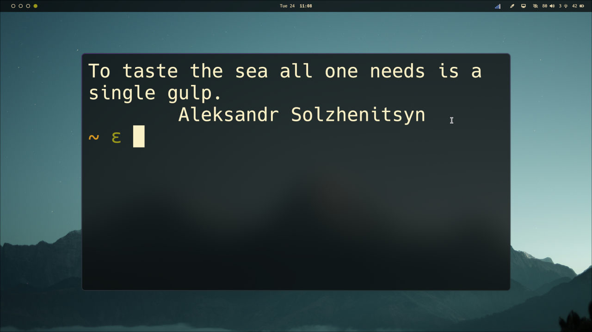

## TLDR
I made a little bash script that I'm releasing to allow users to run `fortune` with a custom database built on JSON, as opposed to the `.dat` file generated with `strfile` that vanilla `fortune-mod` expects when piping in a custom path. The card below provides links to both Codeberg and Github where downloads and install instructions are available.

<center> 
<div class=cardContainer>
    <div class=card data-category="Bash Script">
         
        <h2 class="essays">JSON Fortune</h2>
        <div class="dwnld-preview">
            A script that allows users to run fortune with a custom JSON database.
        </div>
        <a href="https://codeberg.org/makccr/fortune-json" target=_blank><button>Codeberg &nbsp;<i class="icon icon-codeberg"></i></button></a>
        <a href="https://github.com/makccr/fortune-json" target=_blank><button>Github &nbsp;<i class="icon icon-github"></i></button></a>
    </div>
</div>
</center>

### Install Instructions
1. Install dependencies: 

| Distribution | Install Command |
| ------------ | --------------- | 
| Arch Linux | `sudo pacman -Syu git make jq cowfortune` |
| Fedora | `sudo dnf install cowsay fortune-mod git make` |
| Ubuntu | `sudo apt update; sudo apt install cowsay fortune-mod git make` |
2. Clone a repository: 
```bash
git clone https://github.com/makccr/fortune-json
```
3. Build from source: 
```bash
cd fortune-json &&
makepkg -si
```
4. *Optionally* download and use my JSON quotes file: 
```bash 
wget httpS://makc.co/_data/quotes.json &&
fortune-json ~/Downloads/quotes.json
```

---

## How Did We Get Here?
Several years ago now (seven years based on the timeline of the [YouTube video](https://youtube.com/watch?v=ZVXIJfyVbRE) I made on the subject), I discovered the `forrtune` command line app. This was all the way back in the days before I swapped over to running Linux, and simply happened upon an app that could display randomly generated quotes. It wasn't long before I figured out what a `.bashprofile` was, and had a random quote generated every time I opened a terminal window, and only slightly longer before I figured out how to use `strfile` to create a custom database of my own quotes and pipe that into fortune. That discovery led me down the path of linux ricing, and planted the shell that turned into one of my favorite hobbies, and though it may sound a bit absurd, was a not insignificant stepping stone on the path towards swapping off of MacOS and onto Linux, getting into tiling window mangers, and much more. But also, for the last seven years I've consistently had a nice little piece of wisdom or sarcasm to greet me, every time I spawn a new TTY. 

Last week I decided that all the users of my personal website, needed to have the same blissful experience, on every single page of my website. I spent some time putting together a [quotes database](https://makc.co/quotes), by converting my existing fortune database to a `JSON` file that I could reference through 11ty. I then set up the world's dumbest Async function to randomly select and display a quote on the bottom of every single page on my site: 

```javascript
<script>
  (async () => {
    try {
      const response = await fetch("/_data/quotes.json");
      const quotes = await response.json();

      const random = quotes[Math.floor(Math.random() * quotes.length)];

      document.getElementById("quote-text").textContent = random.quote;
      document.getElementById("quote-author").textContent = "" + random.author;
    } catch (err) {
      document.getElementById("quote-text").textContent = "Stay curious.";
      document.getElementById("quote-author").textContent = "";
    }
  })();
</script>
```

Unfortunately, I soon realized that I had broken one of my cardinal rules of life. See, I'm a fundamentally lazy person by nature. I'm perfectly wiling to do hard work when the time to do work presents itself, but I simply cannot abide inefficiency in any process that I use. Even something as small and insignificant as having to maintain two different copies of my quotes database, one for my website and one for my offline terminal use; is enough to drive me absolutely crazy if I force myself to live with it for too long. 

My first idea, was to simply create a bash script to solve the problem for me, as this is my general approach to making my life easier. My `~/.scripts/` directory is full to the brim with miscellaneous scripts that solve one problem in a use case so specific that I have to be the only person in the world that get's any use from it. So I set out to simply create a script that would convert my new `JSON` database to something that I could run through `strfile` and use to generate a new fortune database - or vice versa. I wasn't super picky about which of the two databases that I would use as the *master* in the relationship, but I knew that my plan was to simply edit one, and have both files end up changed. As luck would have it, it's a pretty easy mission to create a simple python script that could remove all the `JSON` formatting, creating a simple text file that could be converted to a `.dat` database with `strifle`. I also couldn't help but acknowledge that it would be very easy to set up a custom macro in Vim that could do literally the same thing, but with less initial set-up compared to a python script. Unfortunately I soon realized that what I had constructed in my head was not the simple solution I had dreamed up, but now a multi-step process that required my actually remembering to trigger it anytime I changed one of the databases: 

1. Change a quotes database, and trigger a script to change the next one. 
2. Convert `JSON` to plain text, or plain text to `JSON`.
3. Generate a database file with `strfile`. 
    * Remove existing database, and clean up any temp file.

While I certainly could have just set-up a few smaller bash scripts, a python script and a mater script to run everything, maybe even have set up a new crontab entry to watch for changes in the directory of one of the two databases, I simply decided that the best thing to do would be to find a way to use one database for both applications. Since the `json` setup with so easy with my static site generator of choice, and I was unlikely to achieve the same level of customization potential using a plain text file for my database, it became clear to me that what I needed to do was mod the `fortune` program to accept input in `json`.
